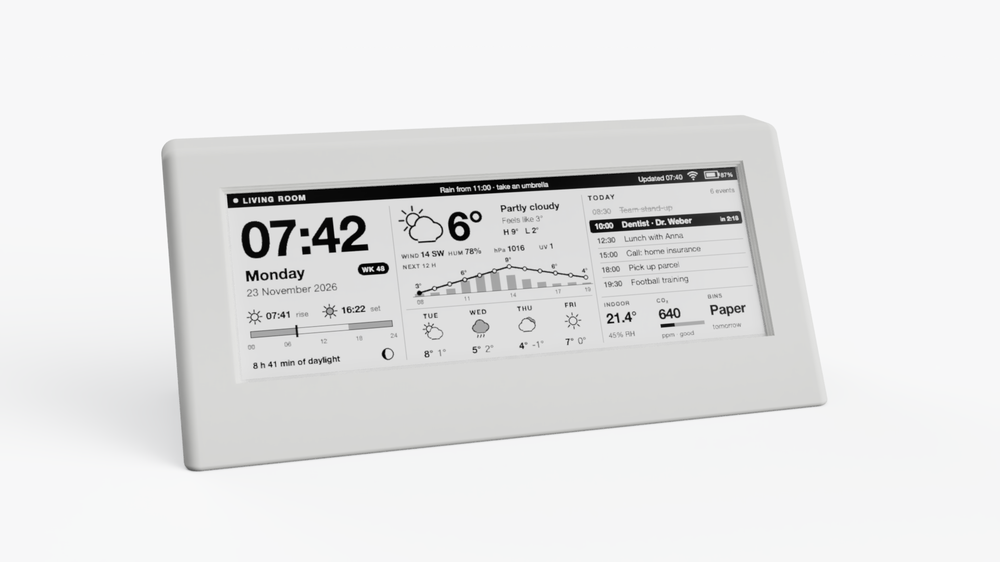

# WallInfoPanel

A battery-powered 5.79" 4-grey e-paper wall panel (Waveshare 792×272 + NodeMCU V3 / ESP8266). It pulls its picture and settings from a small .NET server over Wi-Fi.



| Folder | What |
|--------|------|
| [`WallISetup/`](WallISetup/) | ESP8266 firmware (C++, VS Code + PlatformIO). SETUP mode over USB, RUN mode with deep sleep |
| [`WallIServer/`](WallIServer/) | .NET 10 server: device API, admin API (image upload → dithered 4-grey), the Web Serial **setup page** at `/setup/` and the **admin page** at `/admin/` (devices, status, settings, picture crop/upload) |
| [`docs/protocol.md`](docs/protocol.md) | **The contract** between both: gray2 format, regions, HTTP headers, serial setup protocol |
| [`docs/firmware-design.md`](docs/firmware-design.md) | Modes, setup switch, LED codes, memory plan |
| [`docs/hardware-spec.md`](docs/hardware-spec.md) | Components, feasibility, energy budget, battery choice, wiring |
| [`hw/`](hw/) | Photos of the hardware |
| [`3d-modeling/`](3d-modeling/) | 3D-printed desk case: Fusion model, print-ready STLs, print and assembly guide |
| [`samples/`](samples/) | Sample picture for the panel and the script that generates it |

Quick start:

```bash
cd WallIServer && dotnet run --project src/WallIServer          # server on http://0.0.0.0:5080, setup page /setup/
```

```bash
cd WallISetup && pio run -t upload                                 # flash the panel
```
